<!-- Upload README.md and garden.svg together to the root of your GitHub profile repository. The old banner/systems/divider/koi SVG files are no longer needed. -->

  

 

  
  &nbsp;
  

 

I build at the intersection of **backend engineering, industrial automation and applied AI** — connecting PLCs to modern software, shaping data into useful services, and exploring local LLMs and RAG pipelines.

<b>Text version</b> — about, tools and radar

 

### A little about my work

- **Backend engineering** — .NET services, APIs and dependable data communication.
- **Industrial integration** — bringing PLCs and industrial protocols into modern software ecosystems.
- **Applied AI** — exploring local inference, retrieval pipelines and data-driven systems.

### Tools of the trade

| Layer | Technologies |
| :--- | :--- |
| **Languages** | `C#` · `Python` · `Java` · `SQL` |
| **Backend & infrastructure** | `.NET` · `ASP.NET Core` · `Docker` · `PostgreSQL` |
| **Industrial systems** | `PLC Programming` · `OPC UA` · `Modbus` · `MQTT` |
| **AI & retrieval** | `Local LLMs` · `Hugging Face` · `Vector Databases` · `RAG` |
| **Data & machine learning** | `Pandas` · `NumPy` · `Scikit-learn` · `TensorFlow` · `Keras` |

### On my radar

**Industrial data integration** &nbsp; / &nbsp; **Local LLM & RAG systems** &nbsp; / &nbsp; **Deep learning**

I'm exploring how these pieces fit together: from collecting machine data to building the services and intelligence around it.

 

