<!--
  Kurulum: bu dosyayı kullanıcıadın/kullanıcıadın reposunun kök dizinine koy,
  banner.svg, koi.svg ve divider.svg dosyalarını da aynı repoda "assets/" klasörüne yükle.
-->

<div align="center">




<br/>

<br/>


<br/><br/>


</div>

<br/>

### `> whoami`  <sub>// 私は誰？</sub>

```bash
$ cat identity.config
> Architecting backend infrastructures centered around seamless and high-speed data communication.
> Integrating industrial automation (PLCs) directly into modern software ecosystems.
> Deeply focused on applied AI: Building advanced RAG architectures and deploying Local LLMs.
> Transforming complex data into intelligent, autonomous systems using data science and deep learning.
```

### `> ls /usr/local/skills`  <sub>// 技術</sub>

**`[+] PROGRAMMING_LANGUAGES`**  


**`[+] BACKEND_INFRASTRUCTURE`**  


**`[+] INDUSTRIAL_AUTOMATION`**  


**`[+] AI_&_DATA_SCIENCE`**  


**`[+] LOCAL_LLM_&_RAG`**  


<div align="center">

</div>

### `> ./koi_pond.sh --run`  <sub>// 錦鯉</sub>

<div align="center">
  
</div>

> **鯉の滝登り** *(koi no takinobori)* — in Japanese legend, the koi that fights its way up the waterfall becomes a dragon.
> Same philosophy for code: keep swimming upstream.

### `> cat /learning/focus.md`  <sub>// 学習</sub>

| Area | Focus |
| :--- | :--- |
| **Backend Development** (バックエンド) | .NET / APIs |
| **Industrial Automation** (産業自動化) | PLC Programming |
| **Industrial Data Integration** | OPC UA / Modbus / MQTT |
| **AI & Local LLMs** | RAG Systems |
| **Data Science** (データサイエンス) | Data Analysis / Machine Learning |
| **Deep Learning** (深層学習) | Neural Networks / TensorFlow / Keras |

### `> ping -c 4 user_network`  <sub>// 接続</sub>

<div align="center">
  <a href="https://www.linkedin.com/in/berat-ozkan/">
    
  </a>
  <a href="mailto:16ozkanberat@gmail.com">
    
  </a>
  <br/><br/>
  
  <br/>
  
</div>
