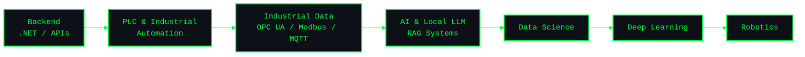

<div align="center">
  
  <br/>
  
  <br/>
  
</div>

<br/>

### `> whoami`

```bash
$ cat identity.config
> Architecting backend infrastructures centered around seamless and high-speed data communication.
> Integrating industrial automation (PLCs) directly into modern software ecosystems.
> Deeply focused on applied AI: Building advanced RAG architectures and deploying Local LLMs.
> Transforming complex data into intelligent, autonomous systems using data science and deep learning.
```


### `> ls /usr/local/skills`

**`[+] PROGRAMMING_LANGUAGES`**  


**`[+] BACKEND_INFRASTRUCTURE`**  


**`[+] INDUSTRIAL_AUTOMATION`**  


**`[+] AI_&_DATA_SCIENCE`**  


**`[+] LOCAL_LLM_&_RAG`**  


### `> execute roadmap.sh`




### `> ping -c 4 user_network`

<div align="center">

  <a href="https://www.linkedin.com/in/berat-ozkan/">
    
  </a>
  <a href="mailto:16ozkanberat@gmail.com">
    
  </a>

</div>
